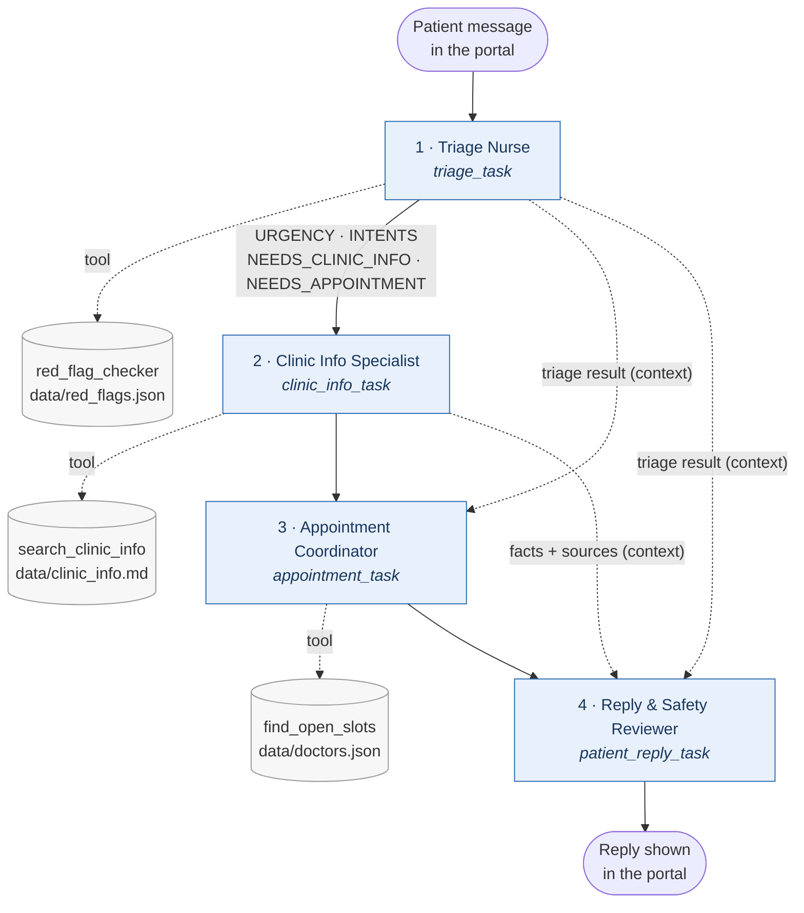

# Agent workflow

How a patient's portal message flows through the four agents (CrewAI, `Process.sequential`).
Each box is one spec card in [config/agents.yaml](../config/agents.yaml) + [config/tasks.yaml](../config/tasks.yaml).



## Routing rules (inside the agents, not code)

| Triage says | Clinic Info Specialist | Appointment Coordinator | Reply & Safety Reviewer |
|---|---|---|---|
| `NEEDS_CLINIC_INFO: no` | `NOT NEEDED`, no tool call | | |
| `NEEDS_APPOINTMENT: no` | | `NOT NEEDED`, no tool call | |
| `URGENCY: EMERGENCY` | also fetches the Emergencies section | `NOT OFFERED: emergency` | first line: call 995 / A&E (SOS 1767), nothing else offered |
| `URGENCY: URGENT` or `ROUTINE` | searches as needed | offers up to 3 slots | answers, lists slots, one next step |

The app also shows a hard-coded 995 banner whenever triage returns `EMERGENCY`, as a backstop.

## Plain-text version

```
Patient message
     │
     ▼
[1] Triage Nurse ──tool──► red_flag_checker
     │  URGENCY / INTENTS / NEEDS_*
     ├──────────────────────────────┬─────────────────────┐
     ▼                              ▼                     │
[2] Clinic Info Specialist    [3] Appointment Coordinator │
     │ tool: search_clinic_info     │ tool: find_open_slots
     │ facts + [source]             │ up to 3 slots       │
     └──────────────┬───────────────┘                     │
                    ▼                                     │
          [4] Reply & Safety Reviewer ◄───────────────────┘
                    │  (no tools; safety rules)
                    ▼
            Reply in the portal
```

## Where things live

| File | Purpose |
|---|---|
| `config/agents.yaml` | Spec cards: role, goal, backstory, tools, llm |
| `config/tasks.yaml` | Spec cards: inputs + objective, output format, done when, context |
| `crew.py` | `@CrewBase` class that loads the YAML and wires tools + LLM |
| `clinic_tools.py` | The three tools |
| `data/` | Fictional clinic handbook, doctor schedules, red-flag phrases |
| `main.py` | CLI: `python main.py "your question"` |
| `app.py` | Streamlit patient portal (chat + spec-card viewer) |
